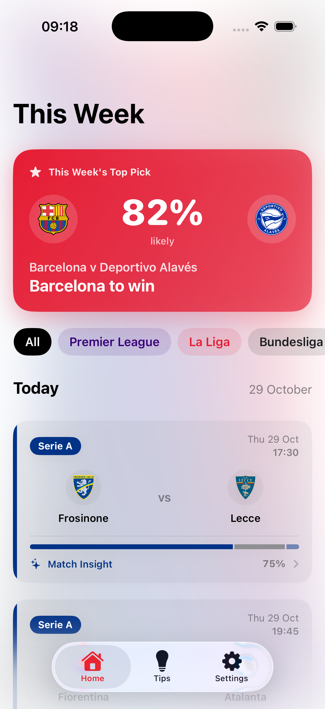
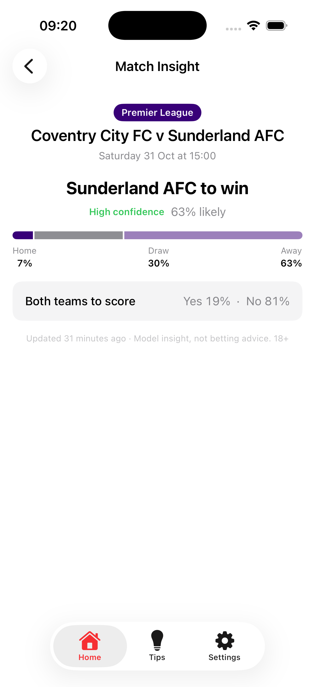
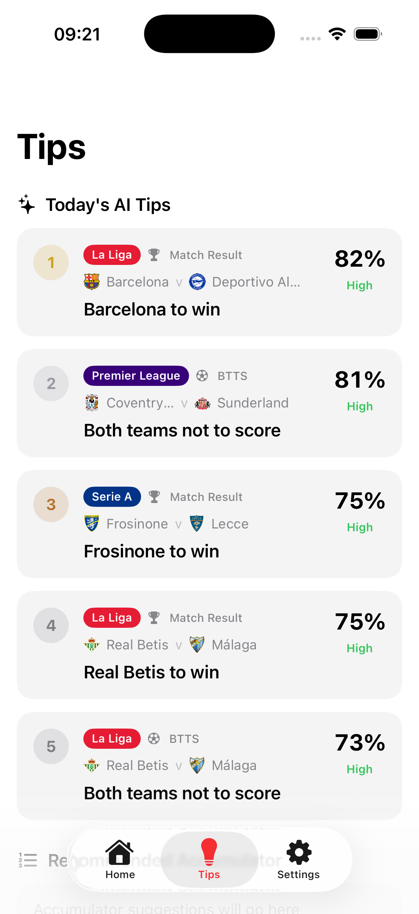

# GameDay AI

An iOS app that shows this week's football fixtures across four leagues and
generates a prediction for each match — entirely on-device, no backend.

<p>
  
  
  
</p>

## What it does

- **Home** — this week's fixtures (Premier League, La Liga, Bundesliga, Serie
  A), grouped by day, pulled live from [TheSportsDB](https://www.thesportsdb.com).
  The week's single highest-confidence pick is pinned at the top as a hero
  card; every fixture card shows an inline win/draw/loss probability bar, and
  league chips filter the list. Tap any fixture — with a zoom transition —
  for the full "Match Insight": a win/draw/loss pick with a confidence level,
  the full probability split, and a both-teams-to-score read.
- **Tips** — the five single highest-probability picks across all of this
  week's fixtures (win picks and BTTS picks pooled together, ranked by how
  confident the model is). A step toward accumulator suggestions next.

## How a prediction is made

No backend, no server call at prediction time — everything below runs on the
device.

1. **History.** For each league, the app pulls roughly three seasons of match
   results from [openfootball](https://github.com/openfootball/football.json),
   a free, open dataset hosted on GitHub.
2. **Fitting.** That history is fed into `GamedayEngine`, a small C library,
   which fits a **Dixon-Coles model** — the standard statistical approach for
   football prediction. It derives, per team, an attack strength and a defence
   strength (how many goals they tend to score/concede relative to the league
   average) plus a shared home-advantage factor. More recent results are
   weighted more heavily via exponential time decay, so current form matters
   more than results from three years ago.

   The fitting method is **iterative proportional fitting**: each team's
   numbers are repeatedly rescaled so its predicted scoring matches its actual
   record, given everyone else's current numbers, until the values converge.
   This is the closed-form maximum-likelihood solution for this class of
   model — not an approximation.
3. **Caching.** The fitted numbers (a handful of floats per team) are saved to
   a small file on-device. Refitting only happens if the cache is more than
   24 hours old.
4. **Prediction.** For an actual fixture, the two teams' attack/defence values
   combine into expected goals for each side. The C engine turns that into a
   full probability distribution over scorelines — a Poisson model, with the
   standard Dixon-Coles correction for low-scoring results (0-0, 1-1, etc.
   being more common than plain Poisson predicts). Summing that distribution
   gives win/draw/loss and both-teams-to-score probabilities.

## Model performance (backtested)

The obvious question for any prediction model is "does it actually work?" —
so rather than just assert it does, `GamedayEngine` ships a CLI
(`GamedayEngine/Sources/Backtest`) that measures it directly against history:

- For each league, fit the model on the **3 seasons immediately before** a
  holdout season — the exact same window and recency-weighting
  `PredictionService` uses in the app.
- "Predict" every match of that holdout season (which the fit never saw) and
  compare the model's win/draw/loss pick against what actually happened.
- Repeat for three separate holdout seasons per league, so results aren't
  down to one lucky/unlucky year.

This is a genuine out-of-sample test: the holdout season's results never
influence the fit used to predict it.

| League | Season | Matches | Model correct | Model accuracy | "Always pick home win" |
|---|---|---|---|---|---|
| Premier League | 2023-24 | 342 | 194 | 56.7% | 46.2% |
| Premier League | 2024-25 | 342 | 177 | 51.8% | 42.1% |
| Premier League | 2025-26 | 342 | 163 | 47.7% | 42.4% |
| La Liga | 2023-24 | 342 | 178 | 52.0% | 43.9% |
| La Liga | 2024-25 | 333 | 176 | 52.9% | 45.3% |
| La Liga | 2025-26 | 306 | 153 | 50.0% | 49.7% |
| Bundesliga | 2023-24 | 240 | 116 | 48.3% | 45.8% |
| Bundesliga | 2024-25 | 240 | 114 | 47.5% | 38.8% |
| Bundesliga | 2025-26 | 272 | 151 | 55.5% | 43.8% |
| Serie A | 2023-24 | 342 | 167 | 48.8% | 41.2% |
| Serie A | 2024-25 | 298 | 163 | 54.7% | 39.9% |
| Serie A | 2025-26 | 342 | 173 | 50.6% | 39.5% |
| **Overall** | **2023-24 → 2025-26** | **3,741** | **1,925** | **51.5%** | **43.2%** |

**Read:** across 3,741 out-of-sample matches spanning 4 leagues and 3
seasons, the model picked the correct 1X2 result 51.5% of the time — a
consistent ~8 point edge over the naive "always bet the home team" baseline,
which is itself a non-trivial benchmark (home advantage is real; draws and
away wins just split the remaining ~57%). Premier League 2023-24 was the
strongest season (56.7%); Bundesliga 2024-25 the weakest (47.5%), which
tracks with the Bundesliga generally being a less home-dominant, higher-
variance league. No league/season dips below the home-win baseline.

**Methodology notes and caveats:**
- Match counts per season are occasionally below a full round-robin (e.g.
  342 rather than 380 for a 20-team league) because a team newly promoted
  into the holdout season has no attack/defence fit — it wasn't in the 3
  training seasons — so its matches are skipped rather than guessed at.
  This affects a handful of fixtures per newly-promoted club, not the model's
  accuracy on fixtures it actually scored.
- "Correct" means the single most-likely outcome (home/draw/away) matched
  the result — the same all-or-nothing scoring a punter would apply, not a
  softer metric like Brier score or log-loss (which the model also implicitly
  optimizes for, but which are harder to put in one sentence).
- Reproduce or extend this yourself:
  ```
  cd GamedayEngine
  swift run -c release Backtest
  ```
  It fetches openfootball history live (no API key needed) and prints this
  table. Edit `backtestWindows` in `Sources/Backtest/main.swift` to test
  different seasons or a longer/shorter training window.

## Resilience: two independent data sources

- **Fixtures to show** (this week's schedule, crests, kickoff times) come
  from TheSportsDB. It's free but shared/rate-limited; when a league's fetch
  comes back empty, the app falls back to openfootball's own schedule data
  for that league automatically. The tradeoff: openfootball doesn't carry
  crest images, so fixtures shown via the fallback display a generic shield
  icon instead of a team badge until TheSportsDB is reachable again — that's
  expected behavior, not a bug, and self-heals on the next refresh.
- **Predictions** never depend on TheSportsDB at all. Once a league has a
  cached fit, generating a prediction is a local file read + on-device math —
  it keeps working through a TheSportsDB outage, and a flaky fixture fetch
  can never overwrite a prediction that's already on screen.

## Architecture

| Piece | What it is |
|---|---|
| `gameday/` | The SwiftUI app: views, and services for fetching fixtures (TheSportsDB + openfootball fallback) and orchestrating predictions. |
| `GamedayEngine/` | A local Swift package. `CGamedayEngine` is the C core doing the statistics; a thin Swift wrapper sits on top. Includes unit tests (reference-value checks for the probability math, synthetic-league checks for the fitting) and the `Backtest` CLI described above. |
| `supabase/` | Legacy — an earlier version ran the same statistics on a Supabase Edge Function. Superseded by the on-device C version, which removes the backend dependency entirely (and was a deliberate exercise in writing the numerical fitting code in C). No longer called by the app. |

## Requirements

- Xcode with an iOS 26+ simulator or device (see `IPHONEOS_DEPLOYMENT_TARGET`
  in the Xcode project if targeting something else).
- No API keys or `.env` setup needed — TheSportsDB is called with its public
  shared test key, and openfootball is a public, unauthenticated GitHub repo.

## Known limitations

- TheSportsDB's shared free key is occasionally rate-limited or briefly
  down; see "Resilience" above for how the app handles that.
- `Settings` is a placeholder screen (static values, no persistence) — not
  yet wired up to real preferences.
- The model currently covers four leagues (Premier League, La Liga,
  Bundesliga, Serie A); cup competitions and leagues with fewer historical
  results available from openfootball aren't modelled.
